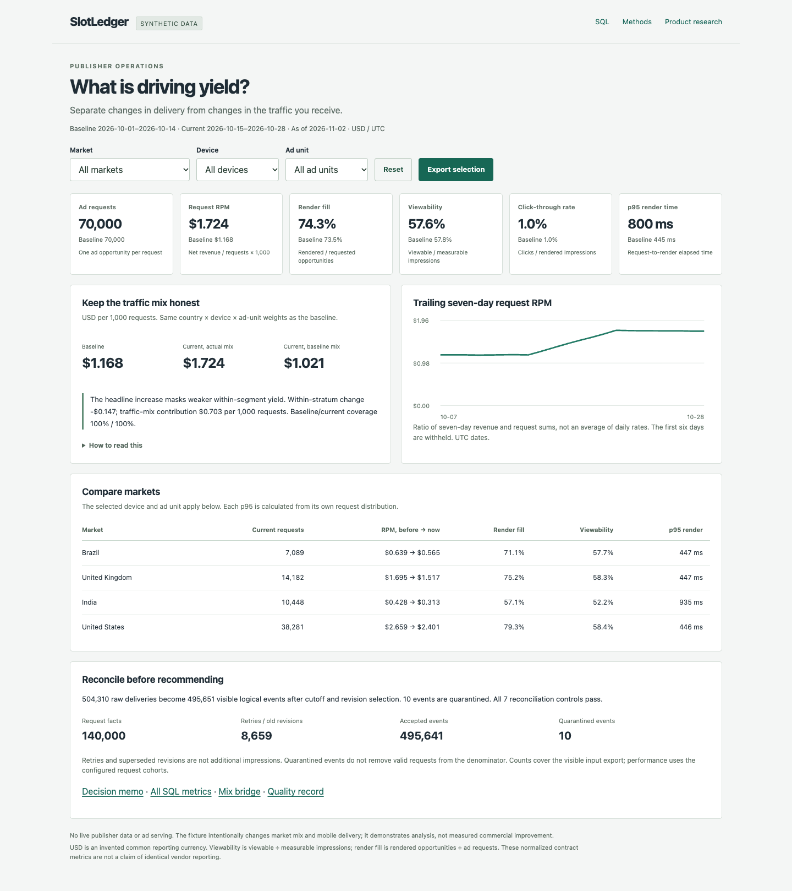

# SlotLedger

A publisher-yield review that asks whether revenue changed because delivery improved or because the traffic mix changed. SQL reconciles request/event exports, calculates market-level measures and decomposes request RPM before a product recommendation is made.

**[Open the review](https://guhanp09.github.io/slot-ledger/)** · [SQL](src/slot_ledger/sql) · [Decision memo](reports/decision.md) · [Product research](docs/landscape.md)



## A useful counterexample

The included fixture has **140,000 synthetic requests across four markets** and **504,310 event deliveries**. Request RPM rises from **$1.168 to $1.724**. Holding the baseline country/device/ad-unit mix fixed gives **$1.021** instead: a change toward higher-yield markets masks weaker delivery and yield within segments.

This is an intentionally generated scenario, not a discovery in customer data. Its purpose is to make a reporting failure reproducible. The analysis identifies a modeled India/mobile rendering regression and recommends investigating a bounded change before a controlled test. It does not claim actual revenue uplift or causal attribution.

## What is implemented

- Cutoff-aware revision selection, retry deduplication, event-chain validation and quarantines.
- One fact per ad request; unfilled opportunities stay in the denominator. Revenue uses signed integer micro-USD amounts.
- `CUBE` rollups with correct ratio denominators and independently calculated p95 latency for every filter combination.
- A fixed-mix bridge with common-support coverage and an exact sequential reconciliation.
- Calendar-complete seven-day windows using sums, `LAG`, segment ranking and a market/device/ad-unit review.
- Responsive report with URL-persisted filters, keyboard controls, CSV export, metric definitions and a decision memo.

The report is a static artifact. It sends no tracking events and requires no account, API key or cloud database.

## Run

Python 3.12 is the validated runtime. From this repository:

```sh
python3 -m venv .venv
source .venv/bin/activate
python -m pip install -e '.[dev]' -c constraints.txt
slot-ledger demo
```

Open `reports/index.html` directly, or serve it:

```sh
python -m http.server 8587 --bind 127.0.0.1 --directory reports
```

Open `http://127.0.0.1:8587`. `slot-ledger demo --requests-per-day 100` creates a smaller fixture. Large raw CSVs stay in ignored `data/generated/`; the included report contains aggregates only.

For a compatible local export, see the [contract](docs/methods.md):

```sh
slot-ledger analyze --data path/to/export --output local-results --as-of 2026-11-02T00:00:00Z
```

## Review the analysis

| Question | Artifact |
|---|---|
| Do event retries inflate revenue? | [Request/event model](src/slot_ledger/sql/01_events.sql), [quality counts](reports/data_quality.json) |
| Are percentages or percentiles averaged incorrectly? | [Metrics and calendar windows](src/slot_ledger/sql/02_metrics.sql) |
| Does traffic composition explain the headline? | [SQL bridge](src/slot_ledger/sql/03_mix_bridge.sql), [export](reports/mix_bridge.csv) |
| Which segment deserves investigation? | [Diagnostics](src/slot_ledger/sql/04_diagnostics.sql), [ranked changes](reports/segment_changes.csv) |
| What should change, and how would it be tested? | [Decision memo](reports/decision.md) |
| What already exists in the market? | [Reporting workflow comparison](docs/landscape.md) |

## Checks

```sh
python -m pytest -q
ruff check src tests
python scripts/check_artifacts.py
npm ci
npx playwright install chromium
npm test
```

To use an already-installed Google Chrome locally instead of downloading Chromium, run `SLOT_LEDGER_BROWSER=chrome npm test`. Hosted verification installs the matching Chromium build.

The Python cases have hand-calculable expected values for missing renders, retries, late revisions, conflicting IDs, invalid event chains, signed adjustments, denominator choice, weighted rates, the mix bridge, missing strata, rolling windows and percentile rollups. Browser checks compare the interface and CSV exports with SQL results, exercise shareable filters and mobile layout, and run automated accessibility checks. Hosted verification and report publishing are defined in [the workflow](.github/workflows/verify.yml).

[Quality review and corrections](docs/quality-review.md) · [Local validation record](docs/validation.json)

## Boundaries

The normalized contract models one display-ad opportunity per request. A `bid` event means an opportunity received a bid; it is not a raw count of bidder responses. No Prebid, Google Ad Manager or OpenRTB connector is implemented. Measurable/viewable flags are simulated rather than measured in a browser. Currency, prices, traffic mix, reporting maturity and regressions are assumed. Vendor metric definitions and settlement rules need mapping before operational use. Proposed stakeholder roles in the memo are not records of actual team meetings.

Initial implementation: November 2026. MIT-licensed code; generated demo data.
